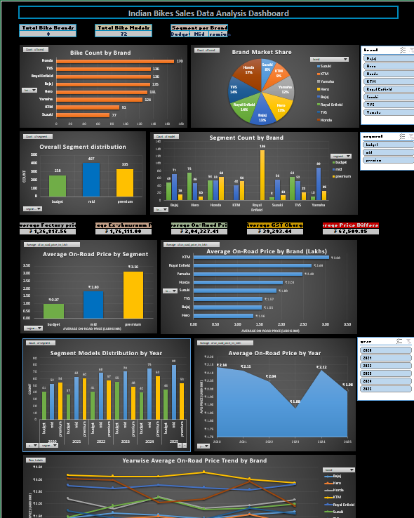
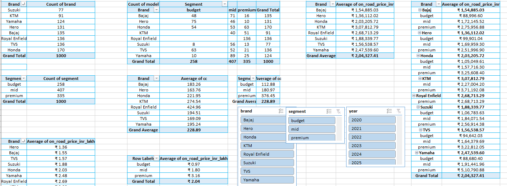
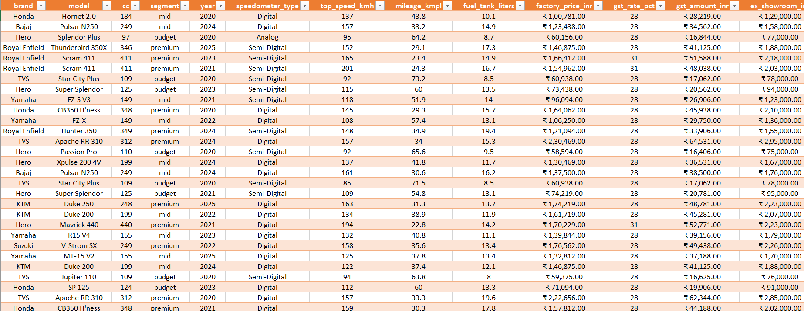

# Indian Bikes Sales & Pricing Analysis Dashboard | Excel

## 📊 Project Overview

This project presents an Indian Bikes Sales & Pricing Analysis Dashboard
created using Microsoft Excel.

The dataset contains 1,000 bike records covering 8 brands and 72 models.
The analysis focuses on brand distribution, bike segments, engine capacity,
pricing, GST, ex-showroom price and on-road price analysis.

## 🎯 Project Objectives

- Analyze bike distribution by brand
- Compare Budget, Mid and Premium segments
- Analyze engine capacity across brands
- Compare factory prices
- Analyze GST charges
- Compare ex-showroom prices
- Analyze on-road prices
- Analyze price differences and markup
- Analyze bike models and yearly distribution
- Build an interactive Excel dashboard
- Generate meaningful insights from the dataset

## 🛠️ Tools & Techniques

- Microsoft Excel
- Pivot Tables
- Pivot Charts
- Slicers
- KPI Analysis
- Data Aggregation
- Data Analysis
- Data Visualization
- Excel formulas

## 📈 Dashboard Features

- Total Bike Brands
- Total Bike Models
- Bike Count by Brand
- Brand Distribution
- Overall Segment Distribution
- Segment Count by Brand
- Average Engine CC by Brand
- Average Engine CC by Segment
- Average On-road Price
- Brand & Segment Analysis
- Pricing Analysis
- Interactive Filters/Slicers

## 📌 Key Insights

- Total Records: 1,000
- Total Brands: 8
- Total Models: 72
- Budget Segment: 258 records
- Mid Segment: 407 records
- Premium Segment: 335 records
- Average Engine Capacity: 228.89 CC
- Average On-road Price: approximately ₹2.04 lakh

Honda has the highest number of records in the dataset with 170 records.

The Mid segment represents the largest segment in the dataset
with 407 records.

## 📊 Brand Distribution

| Brand | Records |
|---|---:|
| Honda | 170 |
| Royal Enfield | 136 |
| TVS | 136 |
| Bajaj | 135 |
| Hero | 131 |
| Yamaha | 124 |
| KTM | 91 |
| Suzuki | 77 |

## 📊 Segment Distribution

| Segment | Records |
|---|---:|
| Budget | 258 |
| Mid | 407 |
| Premium | 335 |

## 📊 Average On-Road Price by Brand

| Brand | Average On-Road Price |
|---|---:|
| KTM | ₹3.08 Lakh |
| Royal Enfield | ₹2.69 Lakh |
| Yamaha | ₹2.48 Lakh |
| Honda | ₹2.03 Lakh |
| Suzuki | ₹1.88 Lakh |
| TVS | ₹1.57 Lakh |
| Bajaj | ₹1.55 Lakh |
| Hero | ₹1.36 Lakh |

## 📂 Dataset Fields

The dataset contains fields such as:

- Brand
- Model
- CC
- Segment
- Year
- Speedometer Type
- Top Speed
- Mileage
- Fuel Tank Capacity
- Factory Price
- GST Rate
- GST Amount
- Ex-showroom Price
- On-road Price
- Price Difference
- Price Markup
- Overall Score
- Price Increase Scenario
- Buyer Behaviour
- Price Sensitivity

## 📷 Dashboard Preview

## 📊 Pivot Analysis

## 📋 Raw Data

## 📁 Project File

The complete Excel workbook is available in this repository:

`Indian_Bikes_Sales_Analysis.xlsx`

## 👨‍💻 Author

Deepak Adhikari